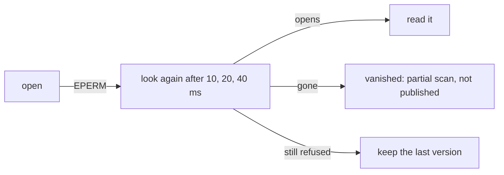

<!--
@license
Copyright (c) rljson

Use of this source code is governed by terms that can be
found in the LICENSE file in the root of this package.
-->

# Work on Windows: no resurrected deletions

## Motivation

- The agent runs on Windows machines, but its test suite had only ever
  passed on Linux and macOS. On Windows it failed 17 to 20 tests, so no
  change to the agent could pass its gate there.
- Two of the failures were bugs in the agent itself, one of them a sync
  defect seen in the field: a file deleted while the scanner opened it came
  back (F6).

## Strategy

- Run the whole suite on Windows and sort every failure: a bug of the
  agent, or a test that assumed POSIX timing, permissions or names.
- Find the cause of F6 before touching it, and prove the fix with a unit
  test that fails without it; then run F6 five times alone.
- Fix the agent where Windows behaves differently from POSIX, not the
  tests that showed it.

## A file being deleted is gone, not locked

- Windows refuses an `open` with EPERM in the moment between a delete
  marking a file and its name going. The scanner took that for a lock and
  kept the file's last version, so the deletion was never authored and the
  next apply wrote the file back.
- A refused open is now tried again after `LOCK_RECHECK_MS` (10, 20 and
  40 ms). A deleted file is gone by then: the scan counts it as vanished,
  and a partial picture is not published. A file a program really holds
  keeps its last version, as before.

## Writes and names on Windows

- `FsBlobAdapter.fileToBlob` names a file by its last path segment on
  either separator. On Windows the name was the whole absolute path, and
  `blobsToFiles` wrote to `<targetDir>/C:\…\file`.
- A rename over a file Windows reports as held (EPERM, EBUSY, EACCES)
  tries again for about half a second. Two writes racing on one path
  failed with EPERM instead of one of them winning.
- A name Windows refuses — over 255 characters, `?`, `*`, `:` — comes back
  as ENOENT there. The restore took it for a missing file and failed; it
  now skips the name, reports it as impossible and applies the rest.

## Tests that hold on Windows

- Deletions are polled instead of read once; the locked-file tests pause
  the watcher, so no scan of its own races them; every cleanup retries the
  folder removal.
- F8 locks its folder with a deny ACL, as `chmod` does nothing to a Windows
  folder; the example golden normalises Windows paths; no `?` in a Windows
  file name.
- F6 had a second cause in the test: with a single seed file, the churn's
  deletions left what an emptied folder looks like, and the all-gone guards
  kept the files on purpose. F6 now seeds more than `ALL_GONE_MIN_FILES`.

## Result

- 823 tests pass on Windows with 100 % coverage, and F6 passes five times
  out of five.
- Plan: ticket 32 of the rljson project management repo.

## Open Points

- On Windows the watcher confirms a deletion only after about half a
  second. An authoring pass that runs before it refuses with "MASS DELETE
  REFUSED … the watcher did not see them go", although it did. The
  deletion is authored once the watcher catches up, so nothing is lost,
  but the message is wrong.
